

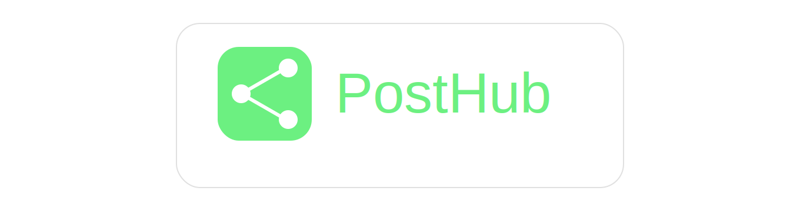

# PostHub

**Plan. Schedule. Publish.**

Ek hi jagah se apni poori social media chalayein — post likhein, schedule karein aur results dekhein, sab ek dashboard mein.

---

## PostHub Kya Hai? (Simple Words Mein)

Sochiye aapki Instagram, Facebook, X (Twitter), LinkedIn, TikTok — sab ek jagah. **PostHub** wahi jagah hai.

Aap ek post likhte hain, aur wo **16 social networks** par ek saath chali jati hai. Aap waqt set kar sakte hain ke post kab lage — chahe raat ho ya aap so rahe hon, PostHub khud publish kar deta hai. Phir batata hai ke post kaisa chala — kitne logon ne dekha, kitne ne like kiya.

**Seedha sa kaam:** ek baar likho → har jagah lagao → results dekho.

## Features

- **Cross-Posting** — Ek post likhein, 16 networks par ek saath publish (Instagram, Facebook, X, LinkedIn, TikTok, YouTube, Threads, Telegram, Discord, WhatsApp aur more)
- **Scheduling & Calendar** — Posts pehle se schedule karein, drag & drop se calendar manage karein, queue khud bharta hai
- **AI Captions** — AI se captions likhwayein, tone badlein, hashtags add karein
- **Analytics** — Har account ka reach, engagement aur top posts dekhein
- **Comment Inbox** — Sab platforms ke replies ek hi inbox mein, bina 6 apps khole
- **Team Collaboration** — 25 tak team seats, drafts par comments, approvals, live preview
- **Video Transcripts** — Video upload karein, captions/transcript milein
- **Accounts** — 16 networks connect karein, koi alag API keys lene ki zaroorat nahi

## Screenshots

### Homepage
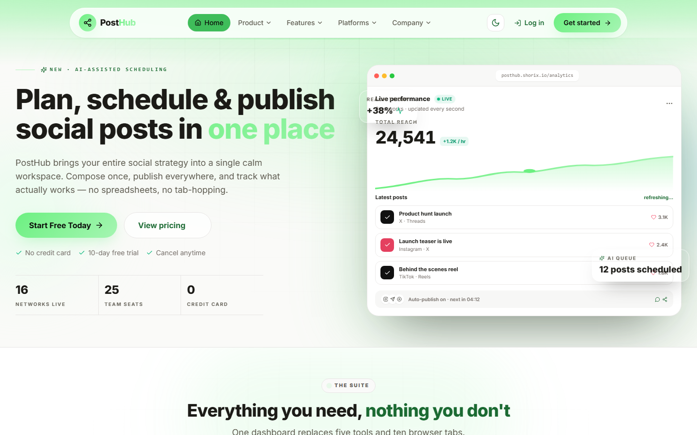

### Product
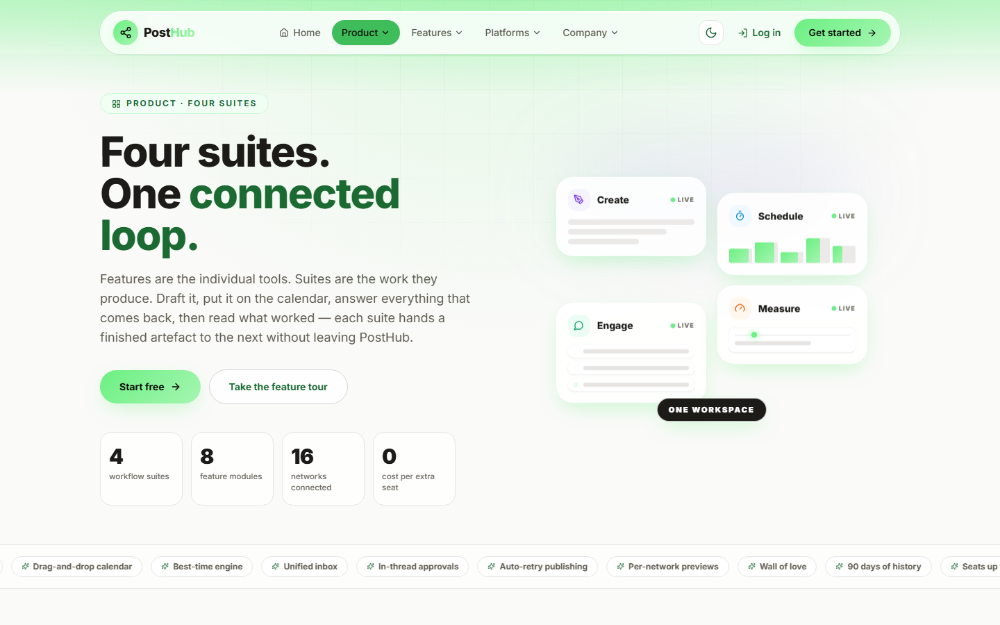

### Features
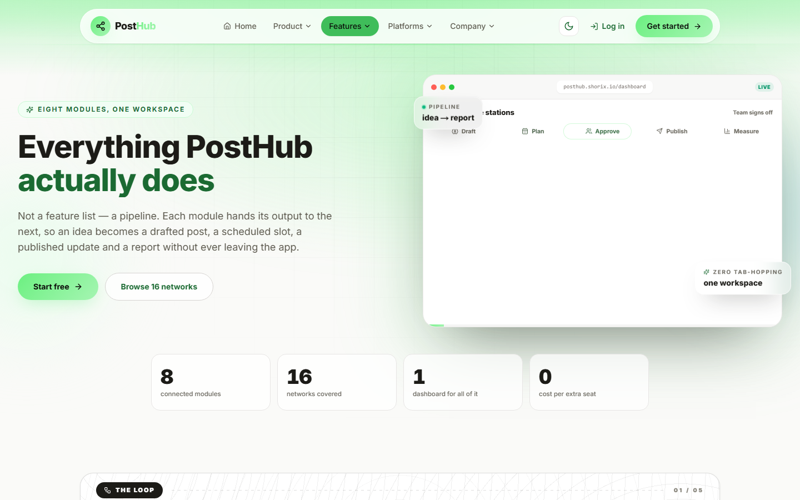

### Platforms
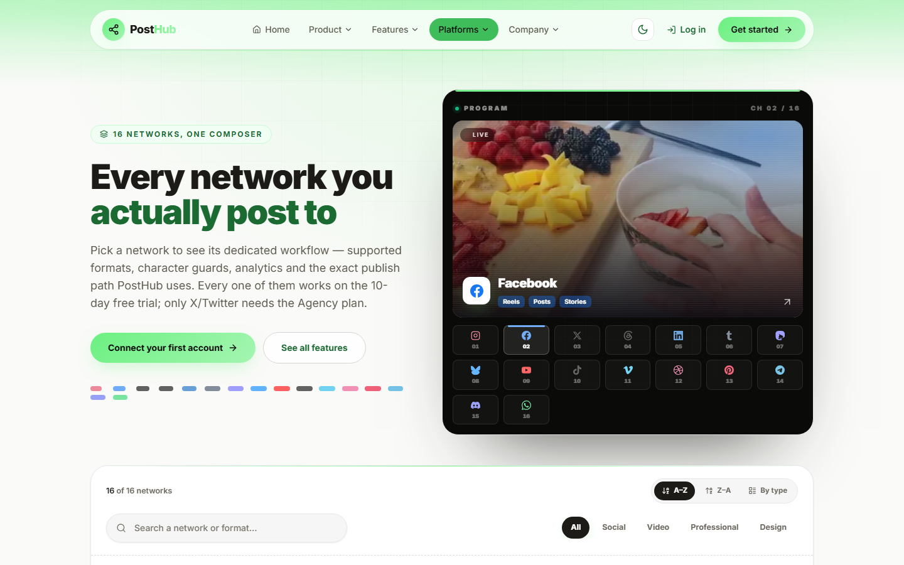

### Pricing
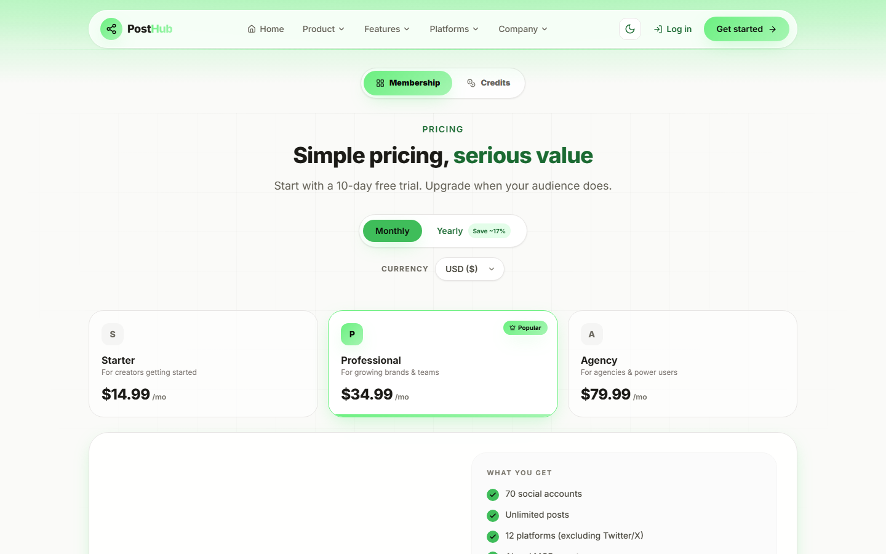

### About
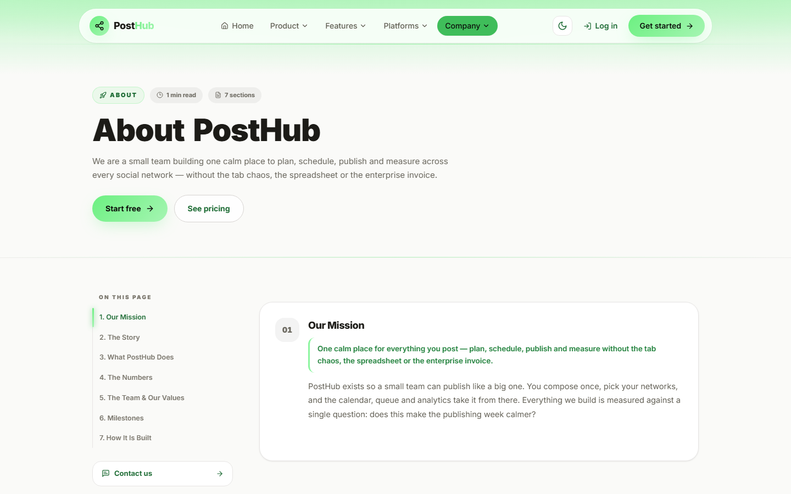

### Contact
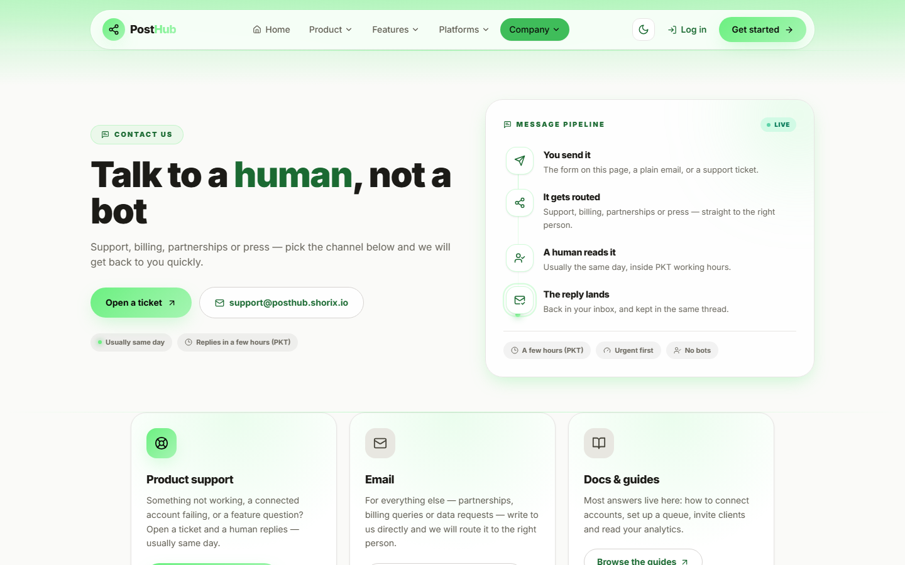

### Login
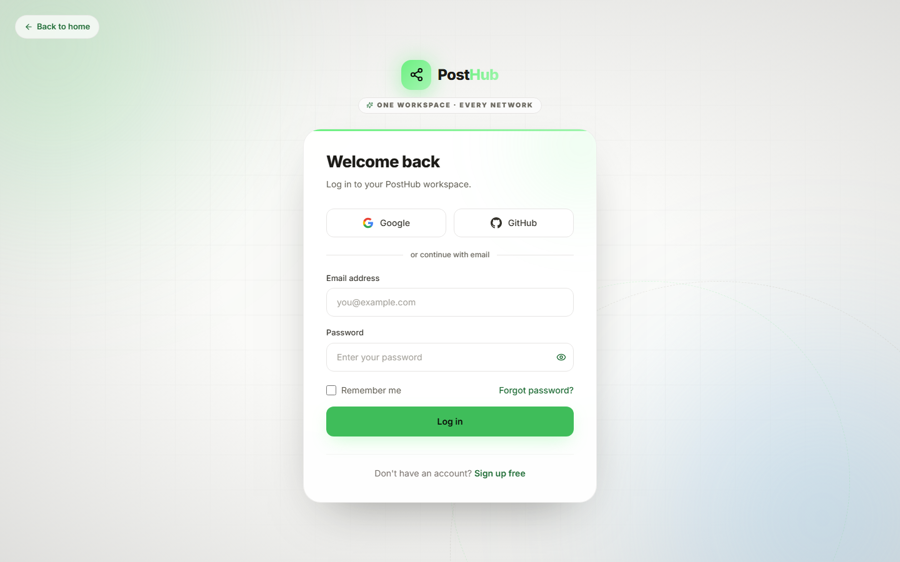

### Sign Up
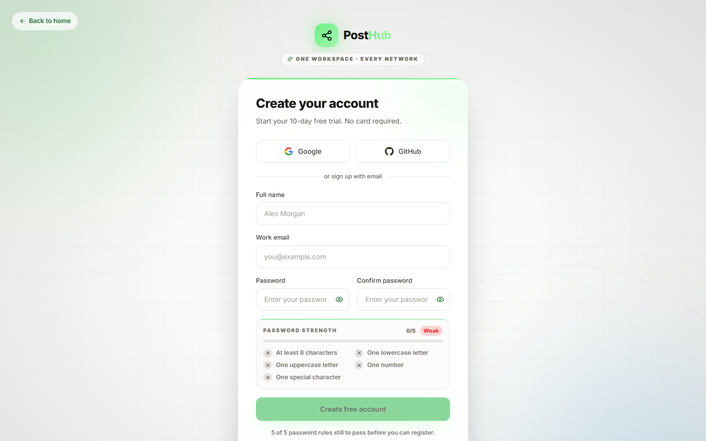

### Changelog
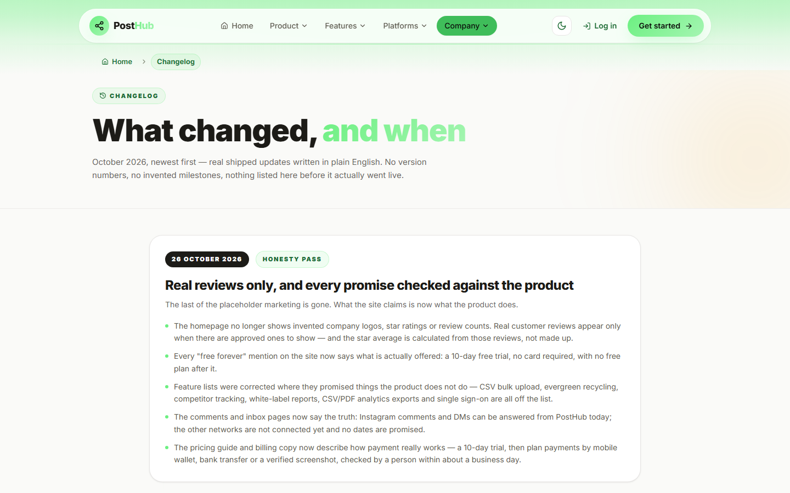

### Blog
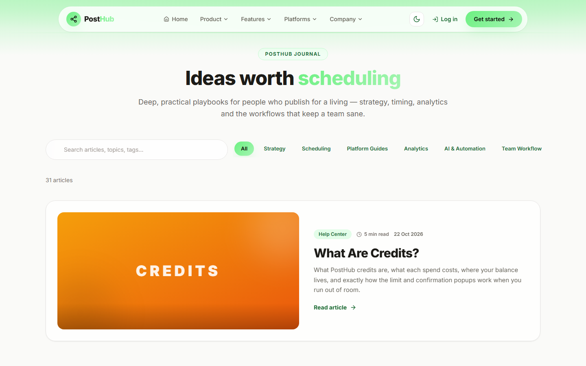

### Support
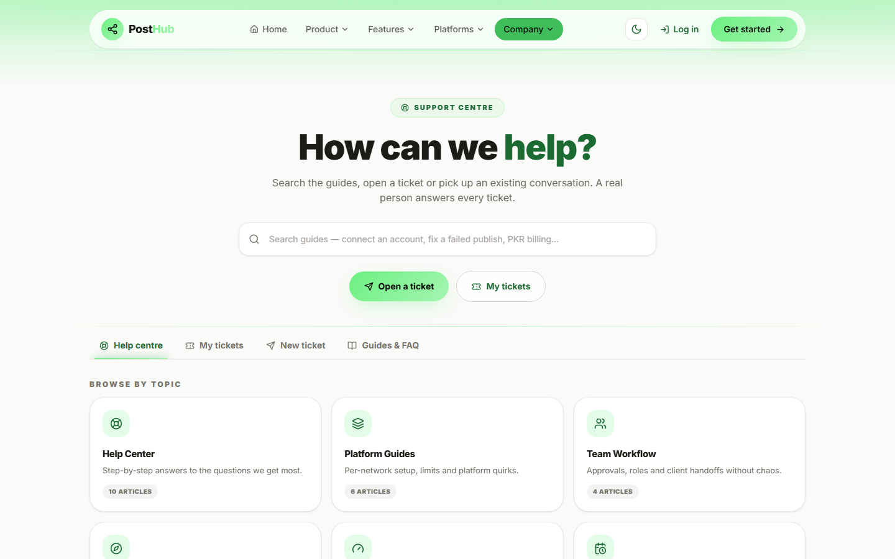

## Tech Stack

| Layer | Technology |
|-------|-----------|
| Frontend | Next.js 15, React 18, TypeScript, Tailwind CSS |
| Backend | Next.js API routes (ek hi Node process) |
| Database | MySQL |
| Auth | Email + OTP, Google OAuth, GitHub OAuth, JWT |
| Email | Resend |
| Animation | Framer Motion |
| Charts | Recharts |
| Deployment | Hostinger (Linux) |

## Kyun PostHub?

- **16 networks, ek dashboard** — 5 tabs aur spreadsheet ki zaroorat nahi
- **10-day free trial** — credit card nahi chahiye
- **AI assisted** — captions, best time aur queue khud manage hota hai
- **Teams ke liye** — approvals aur client workspaces built-in
- **PKR billing** — Pakistan ke liye local pricing

## Live

**[posthub.shorix.io](https://posthub.shorix.io)**

---

Built with care from Pakistan

